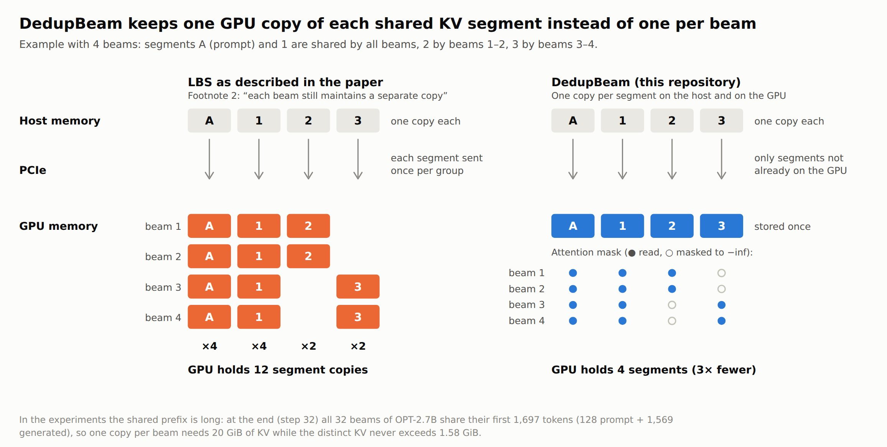
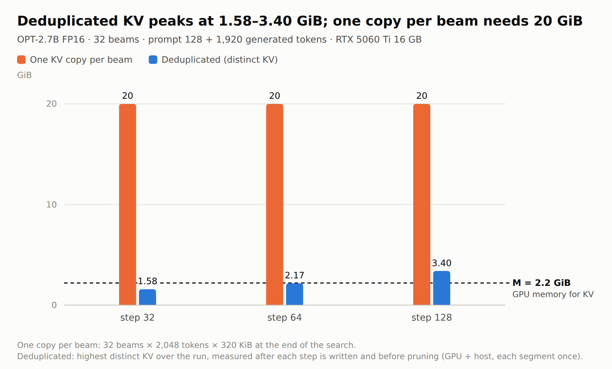
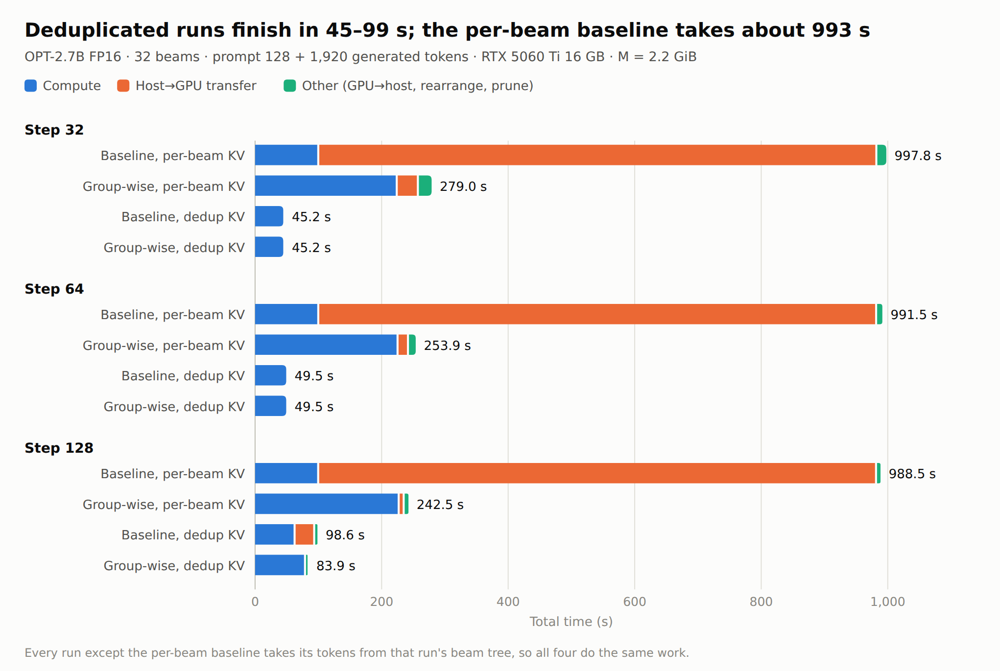
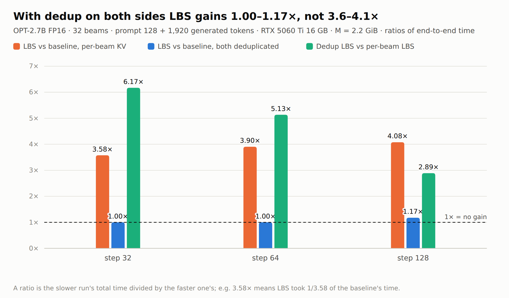
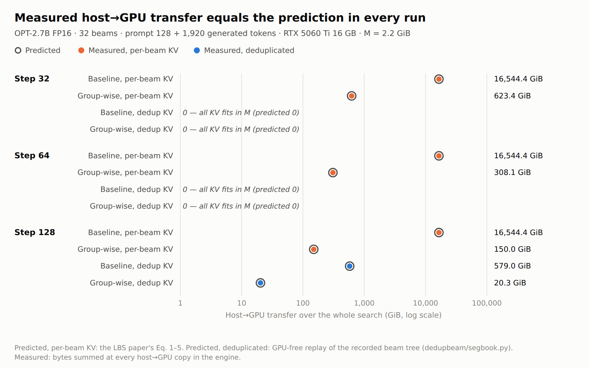
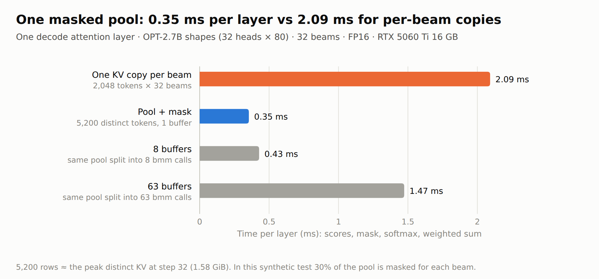
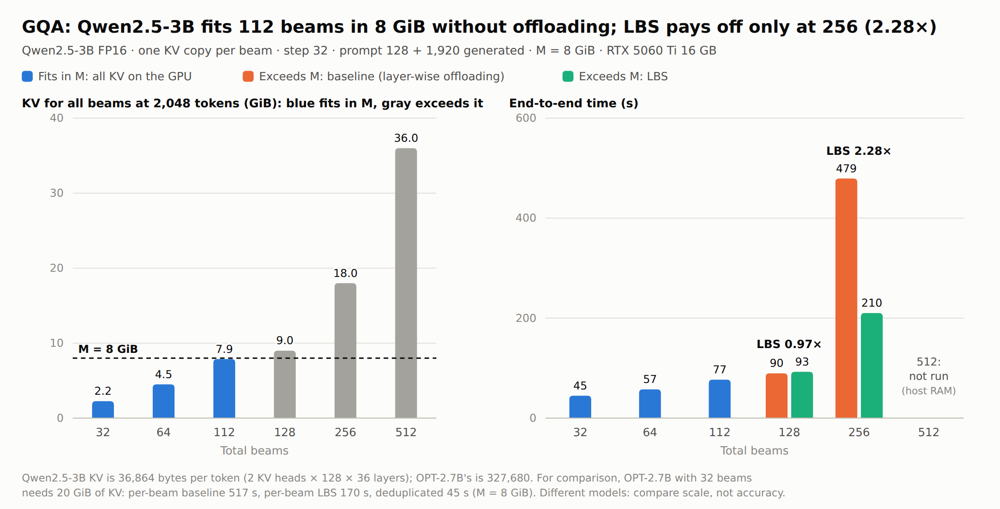

# DedupBeam

DedupBeam stores the KV cache of shared beam prefixes once, on the host and on the GPU, instead of once per beam. On OPT-2.7B with 32 beams it cuts peak KV from 20 GiB to 1.6–3.4 GiB and runs 2.9–6.2× faster than LBS-style beam scheduling (MLSys 2026) and 11.8–22.1× faster than layer-wise KV offloading at the same 2.2 GiB GPU budget, using only standard PyTorch ops (no custom kernel).



## Key results

Setup: OPT-2.7B in FP16, 32 beams, beam width 2 (half of the beams survive each step), prompt of 128 tokens, 1,920 generated tokens, cumulative log-probability scoring, Gumbel-max sampling with seed 0, one RTX 5060 Ti 16 GB (PCIe 5.0 x8, 18.6 GiB/s host→GPU). M is the GPU memory reserved for KV. M = 2.2 GiB keeps roughly the ratio between total KV and M of the paper's Fig. 7 (7 GB reserved for KV; 64 beams of OPT-6.7B at 2,048 tokens hold 64 GiB of per-beam KV by our count, about 9×; here 20 GiB vs 2.2 GiB).

Two schedules are compared, each with one KV copy per beam and with DedupBeam's deduplicated KV: layer-wise KV offloading (the baseline) and LBS-style beam scheduling (reordering only). The ratios in the opening paragraph compare the "LBS, dedup KV" column with "LBS, per-beam KV" (2.9–6.2×) and with "Baseline, per-beam KV" (11.8–22.1×).

End-to-end time at M = 2.2 GiB (seconds) and the ratios between them:

| Step length | Baseline, per-beam KV | LBS, per-beam KV | Baseline, dedup KV | LBS, dedup KV | LBS vs baseline, per-beam KV | LBS vs baseline, both dedup | Dedup LBS vs per-beam LBS |
|---|---|---|---|---|---|---|---|
| 32 | 997.8 | 279.0 | 45.2 | 45.2 | 3.58× | 1.00× | 6.17× |
| 64 | 991.5 | 253.9 | 49.5 | 49.5 | 3.90× | 1.00× | 5.13× |
| 128 | 988.5 | 242.5 | 98.6 | 83.9 | 4.08× | 1.17× | 2.89× |

- With per-beam KV, LBS is 3.6–4.1× faster than the baseline. (The paper reports 3.39–9.72× end to end on an RTX 4090 for its full method, which also includes prefix-aware grouping and prefetching.)
- With dedup on both sides, the distinct KV peaks at 1.58 / 2.17 / 3.40 GiB instead of 20 GiB. At step 32 and 64 it fits in M, nothing is transferred, and LBS and the baseline take the same time. At step 128 the baseline transfers 579 GiB and LBS 20 GiB, and LBS is 1.17× faster.







## Motivation

Step-wise beam search keeps many beams that share long prefixes. When the KV cache of all beams does not fit in GPU memory, layer-wise offloading decodes all beams token by token and reloads every offloaded layer for every token. [Locality-Aware Beam Scheduling for Efficient Test-Time Compute with a Consumer-grade GPU](https://proceedings.mlsys.org/paper_files/paper/2026/file/c74b624843218d9b6713fcf299d6d5e4-Paper-Conference.pdf) (LBS, MLSys 2026) reorders the work: a group of beams loads its KV once and decodes a whole step before the next group runs. The paper also groups beams with shared prefixes so that each shared segment crosses PCIe once, and prefetches the next group.

In both designs the GPU still holds one copy of the shared KV per beam. Footnote 2 of the LBS paper attributes this to kernel layout: "each beam still maintains a separate copy of the shared KV cache once loaded into GPU memory due to CUDA kernel layout constraints". This repository shows that standard PyTorch ops are enough to store the shared KV once, on the host and on the GPU, and measures what that leaves for offloading and scheduling to optimize.

## How it works

- **Segments and pools** (`dedupbeam/dedup.py`, `dedupbeam/segbook.py`): the KV that one beam wrote in one step is a segment; a segment is stored once and shared by every beam that descends from it. Each layer keeps one K pool and one V pool (one row per distinct token).
- **Attention over the shared pool:** scores are computed against the whole pool in one `bmm`, rows the beam does not own get `-inf`, one softmax is applied, and one more `bmm` produces the weighted sum. This demonstrates dedup is implementable with standard PyTorch ops (`bmm`, `softmax`, `masked_fill`); there is no custom kernel.
- `SegBook` (`dedupbeam/segbook.py`) records, for every beam, the chain of segments it descends from, and where each segment lives in the GPU pool and in the host pool. Pruning never copies KV: a dropped slot simply points at the survivor's chain, and segments nobody uses are freed and the pools compacted.
- Both schedules have a dedup version:
  - **Baseline (dedup):** all beams in one batch, token by token. The number of GPU-resident layers is Eq. 1 with the layer size taken over distinct tokens; the other layers are reloaded every token, distinct content only. When pruning frees room, layers move back to the GPU (counted as transfer).
  - **LBS (dedup):** beams are ordered by their segment chains so that beams sharing the most are adjacent, and packed into groups whose distinct old segments plus this step's new segments fit in M. Segments that the next group also needs stay on the GPU; only missing segments are loaded. (Without that retention, step 128 at M = 2.2 GiB would move 26.2 GiB instead of 20.3 GiB.)

## Baselines

The LBS-style baseline implements only LBS's reordering; the paper's prefix-aware grouping and prefetching are not implemented. Both baselines are reimplemented here so that they run with the same model, sampling, scoring and GPU memory budget as DedupBeam.

- **Per-beam engine** (`dedupbeam/perbeam.py`): step-wise beam search with one KV copy per beam, in three modes: all KV on the GPU, the layer-wise offloading baseline, and LBS (reordering only; no prefix grouping, no prefetching). It reproduces the paper's transfer-volume model (Eq. 1–5) to the byte.
- **Check against the paper's model** (per-beam KV, M = 8 GiB, step 32): 8 / 16 / 24 / 32 beams give LBS speedups of 1.00× / 1.12× / 2.22× / 3.05×, and the transfer volumes (0 / 468.2 / 3,510.9 / 7,635.7 GiB for the baseline, 0 / 115.8 / 341.0 / 536.2 GiB for LBS) match Eq. 1–5 exactly. The paper reports up to 6.85× on an RTX 3080 Ti with OPT-2.7B (its §5.5); its method also includes prefix-aware grouping and prefetching, and only reordering is implemented here.

## More results

### Tighter budget (M = 1 GiB)

With a tighter M = 1 GiB (both dedup), LBS is 0.87× / 1.02× / 1.29× of the baseline for step 32 / 64 / 128. LBS splits the beams into groups, and every group reads the model weights once per token, which costs more compute than the transfer it saves when the transfer is already small.

### Predicted vs measured transfer

Measured host→GPU bytes equal the prediction in every run: the paper's Eq. 1–5 for per-beam KV, and a GPU-free replay of the recorded beam tree for dedup.



### Attention microbenchmark

The single pool with a mask is faster than splitting the shared KV into one buffer per run of segments shared by the same beams (that layout needs up to 31 buffers per step here):



The masked pool computes scores for rows a beam cannot see: 3.1× / 4.2× / 6.7× more score rows than needed at step 32 / 64 / 128. Decode attention is limited by memory reads, so it is still cheaper than reading per-beam copies: with all beams in one batch and nothing transferred, compute takes 44.5 / 49.2 / 64.0 s with dedup KV against 101.3–101.5 s with per-beam KV.

### GQA model

A GQA model class (`dedupbeam/gqa.py`) runs Qwen2.5-3B with the same interface, to see whether a model with grouped-query attention needs offloading at all at this search size. Qwen2.5-3B stores 36,864 bytes of KV per token (2 KV heads × 128 dims × 36 layers), 11% of OPT-2.7B's 327,680. With M = 8 GiB it fits 112 beams of 2,048 tokens without offloading; 32 beams take 44.9 s. At 128 beams LBS is 0.97× of the baseline and at 256 beams 2.28×. 512 beams were not run (they need 28–36 GiB of pinned host memory).



All numbers, including the M = 1 GiB runs and the per-run breakdowns, are in [`results/tables.md`](results/tables.md). Each run's JSON summary is in `results/`.

## Correctness checks

The results above were produced by this code before it was reorganized into this repository. After the reorganization, the per-beam and dedup engines were run side by side with the original code on small settings (OPT-2.7B and Qwen2.5-3B, every mode); tokens, scores, beam trees and every byte counter were bitwise identical. The checks below were then rerun with this repository's code (logs in [`results/checks/`](results/checks)):

| Script | What it checks | Result |
|---|---|---|
| `scripts/check_percopy.py` | Per-beam engine, OPT-2.7B, 4 small settings that overflow M. FP16: our forward matches the HF forward (argmax agrees on all 128 prompt positions); baseline and in-GPU produce bitwise identical beam trees; LBS and in-GPU decoded in the same groups are bitwise identical; transfer bytes equal Eq. 1–5. FP32: all modes produce identical tokens and trees. | pass |
| `scripts/check_dedup.py` | Dedup engine, OPT-2.7B, 4 small settings. FP16: dedup baseline (offloading) and dedup in-GPU give bitwise identical trees; dedup LBS and the same flow with the host copy kept on the GPU are bitwise identical; transfer bytes equal the beam-tree replay. FP32: per-beam in-GPU, dedup in-GPU, dedup baseline and dedup LBS produce identical tokens and trees (score differences ≤ 7e-5). | pass |
| `scripts/check_gqa.py` | Qwen2.5-3B model class. FP32 logits match HF within 1.5e-4 with identical argmax; a whole 96-token, 4-beam decode matches HF's log-probabilities within 6.3e-5; offloading checks as above. | pass |

Under FP16, a run with a different batch size or KV layout rounds differently and, when it samples on its own, eventually picks a different token, after which the beams diverge. The large experiments therefore let one run per step length sample freely and make every other run follow its beam tree; `results/tables.md` lists how close each forced run's own log-probabilities are (at most 0.155 per token).

## Reproduce

Hardware used: RTX 5060 Ti 16 GB on PCIe 5.0 x8, 31 GiB of host memory, Linux. The per-beam LBS run with 32 beams pins 20 GiB of host memory; the dedup engine reserves 10 GiB. A smaller GPU or less host memory needs smaller settings.

```bash
python -m venv .venv && source .venv/bin/activate
pip install torch==2.11.0 --index-url https://download.pytorch.org/whl/cu128
pip install -r requirements.txt
```

The models are downloaded from the Hugging Face Hub on first use (`facebook/opt-2.7b`, about 5.3 GB; `Qwen/Qwen2.5-3B`, about 6.2 GB, under the Qwen Research License, non-commercial use). Set `HF_HOME` to choose where they are stored.

| Command | What it does | Time on the machine above |
|---|---|---|
| `python scripts/check_percopy.py` | correctness, per-beam engine | about 4 min |
| `python scripts/check_dedup.py` | correctness, dedup engine | about 6 min |
| `python scripts/check_gqa.py` | correctness, Qwen2.5-3B | about 4 min |
| `python scripts/measure_machine.py` | PCIe link and bandwidth, pinnable memory, matmul → `results/machine.json` | about 1 min |
| `scripts/run_repro.sh` | LBS reproduction, 8–32 beams, M = 8 GiB → `results/repro/` | about 25 min |
| `scripts/run_dedup.sh` | dedup experiment, step 32 / 64 / 128 → `results/dedup/` | about 1.5 h |
| `scripts/run_gqa.sh` | Qwen2.5-3B, 32–512 beams → `results/gqa/` | about 20 min |
| `python scripts/microbench_attention.py` | one-layer attention microbenchmark → `results/microbench_attention.json` | under 1 min |
| `python scripts/make_tables.py` | `results/tables.md` | seconds |
| `python scripts/make_figures.py` | `figures/*.svg` and `figures/*.png` (PNG needs rsvg-convert, cairosvg, or Chrome/Chromium; `CHROME=/path` selects one) | seconds |

A single run: `python scripts/run.py --exp NAME --store {percopy,dedup} --mode {ingpu,baseline,lbs} --beams 32 --step 32 --mem-gib 2.2 [--model qwen] [--force-tree TREE.npz]`. Each run writes `results/NAME/<store>_<mode>_N<beams>_step<step>_M<mem>.json` and its beam tree to `results/NAME/trees/`. The batch scripts skip runs that already finished, so an interrupted batch resumes. `run.py` refuses to start if another process is using the GPU.

Beam-tree files (`.npz`) hold, for every step and slot, the parent slot, the generated tokens, per-token log-probabilities, the cumulative score and whether the candidate survived, plus a JSON header with the settings. Only the three reference trees of the dedup experiment are included (`results/dedup/trees/`); they are what the dedup transfer predictions replay.

## Repository layout

Scripts run everything, check correctness, and regenerate every table and figure from the JSON results.

```
dedupbeam/   engines and models: common, opt, gqa, perbeam, segbook, dedup, predict
scripts/     run.py and batch scripts, check_*.py, measure_machine.py, microbench_attention.py, make_tables.py, make_figures.py
data/        prompt.txt (the fixed prompt; the first 128 tokens are used)
results/     run summaries (JSON), machine.json, microbench_attention.json, checks/, tables.md
figures/     SVG and PNG figures
```

## Limitations

- One model and one search size for the main result: OPT-2.7B, 32 beams, beam width 2, 2,048 tokens, one prompt, one seed, cumulative log-probability scoring. How much the beams share depends on the model, the prompt, the scoring and the sampling; with less sharing, dedup saves less and LBS has more left to do.
- Accuracy and output quality were not measured; the experiments measure memory, transfer and time.
- M was scaled to keep the paper's ratio of KV to GPU memory; the paper's own settings (OPT-6.7B, 64 beams, RTX 4090) were not run.
- The LBS implementation here reorders only. Prefix-aware grouping and prefetching from the paper are not implemented, so the per-beam LBS numbers are not the paper's full method.
- Storing shared KV once is the idea behind PagedAttention (vLLM). This repository does not use vLLM or paged memory; it uses one contiguous pool per layer with an attention mask, which computes scores for masked rows. A paged or prefix-aware attention kernel would avoid that waste.
- Timings come from one machine and one run per configuration; transfers and compute are timed with a device synchronization between them, so no transfer overlaps compute.
- The GQA comparison uses a different model (Qwen2.5-3B), so it compares how much KV a search of this size needs and how long it takes, not output quality.

## License

MIT, see [LICENSE](LICENSE). The LBS paper is not included; see the link above. Model weights are downloaded from the Hugging Face Hub under their own licenses.
